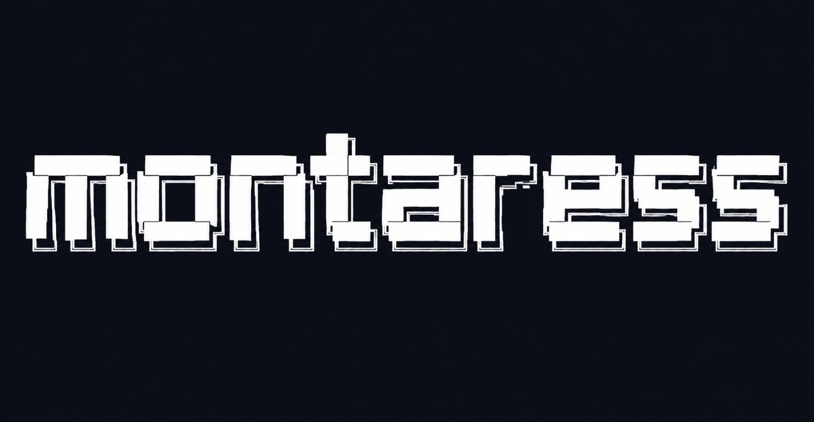

<div align="center">



</div>

---

<div align="center">

**Independent developer · Personal software projects**

`Python`　`C#`　`HTML`　`JavaScript`

</div>

## > `montaress@github`

> welcome to my profile

---

### `01 / ABOUT`

```text
> developer
> building personal software projects
```

### `02 / LANGUAGES`

<p>
  
  
  
  
</p>

### `03 / CURRENT FOCUS`

```text
> No
> No
> No
```

### `04 / PROJECTS`

```text
> Reverse
```

---

### `STATS`

<div align="center">


</div>

<div align="center">

`[ END OF FILE ]`

</div>
